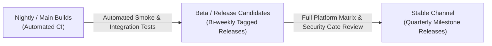

# Operations and Support Plan (Round 1 Exit)

- **Status:** Approved / Operational Baseline
- **Date:** 2026-10-15
- **Target Release:** `v0.1.0-alpha`
- **Owners:** Operations Lead, Systems Architect, Support Lead
- **Governing Requirements:** [01-product-requirements.md](file:///d:/Projects/universal-mobile-runtime/docs/01-product-requirements.md), [07-test-and-acceptance-plan.md](file:///d:/Projects/universal-mobile-runtime/docs/07-test-and-acceptance-plan.md), [08-roadmap.md](file:///d:/Projects/universal-mobile-runtime/docs/08-roadmap.md)

---

## 1. Purpose & Scope

This operations plan defines the release lifecycle, packaging topology, diagnostic support workflow, incident management, and maintenance processes for the Universal Mobile Runtime (UMR) platform across Windows, macOS, and Linux desktop hosts.

---

## 2. Release Channels & Cadence

| Channel | Target Audience | Stability Guarantee | Update Frequency |
| :--- | :--- | :--- | :--- |
| **Nightly** | Core developers and backend contributors | Experimental; may contain partial features | Daily on successful CI runs |
| **Beta** | Application publishers, testers, power users | Feature-complete; passes automated smoke suite | Bi-weekly |
| **Stable** | General desktop users and enterprise fleets | Production-grade; full platform matrix verified | Quarterly or critical patch |

---

## 3. Packaging & Distribution Topologies

### Windows (x86-64 / ARM64)
- **Installer:** Windows Installer (`.msi`) or MSIX packaging.
- **Portable:** Standalone zip package containing `umr-ipc.exe`, `umr-intake-worker.exe`, and shell assets.
- **Hypervisor Requirements:** Hyper-V / Windows Hypervisor Platform (WHPX) enabled. Fallback to reference backend for environments where virtualization is unavailable.

### macOS (Apple Silicon ARM64 / Intel x86-64)
- **Application Bundle:** Notarized `Universal Mobile Runtime.app` inside a signed `.dmg`.
- **Entitlements:** Hardened runtime with `com.apple.security.virtualization` and `com.apple.security.network.client`.
- **Simulator Bridge:** Integrates with local Xcode command-line tools (`xcrun simctl`).

### Linux (x86-64 / ARM64)
- **Packaging:** AppImage, Flatpak (with sandbox hole for KVM/Binderfs), and standalone tarball.
- **Kernel Requirements:** KVM permissions (`/dev/kvm`), user namespaces, and optional Binderfs support.

---

## 4. Diagnostic Support & Telemetry Workflow

### Privacy-Preserving Support Bundles
1. **User Initiation:** Users generate a support bundle via Desktop Shell UI or `umr.support.generate_report` RPC method.
2. **Automated Scrubbing:** The `SupportReportGenerator` scrubs all sensitive tokens, passwords, private keys, email addresses, and host user home directory paths.
3. **User Inspection:** Before export, the user is presented with a summary of the report data and an explicit confirmation prompt.
4. **Export Artifact:** A self-contained JSON/ZIP archive containing host specs, active backends, installed package provenance status, and redacted session logs.

### Issue Triage & Severity Matrix

| Severity | Definition | Target First Response | Target Mitigation |
| :--- | :--- | :--- | :--- |
| **P0 - Blocker** | Security vulnerability, host memory corruption, or complete shell launch failure across all hosts. | < 4 hours | < 24 hours |
| **P1 - Critical** | Backend crash during execution of verified cohort apps; regression in package intake. | < 12 hours | < 72 hours |
| **P2 - Major** | Incompatible framework gap on supported iOS track; input/frame latency degradation. | < 2 business days | Next release cycle |
| **P3 - Minor** | Cosmetic UI issue, non-blocking diagnostic log formatting, documentation typo. | < 5 business days | Next milestone |

---

## 5. Security Incident Response & Disclosure

- **Contact Point:** `security@universal-mobile-runtime.org`
- **PGP Key:** Published on the official repository security policy page.
- **Response Workflow:**
  1. **Receipt & Acknowledgment:** Within 24 hours of report submission.
  2. **Triage & Reproduction:** Isolated reproduction test created within 48 hours.
  3. **Remediation & Patching:** Patch authored in private security advisory branch; tested against full test suite.
  4. **Coordinated Disclosure:** Release published alongside public CVE advisory following a 90-day responsible disclosure window.

---

## 6. Deprecation & Lifecycle Policy

- **Minimum Notice:** A minimum of 6 months notice will be provided prior to deprecating any host OS version, hypervisor backend, or supported app cohort.
- **Legacy iOS HLE (Track B):** Maintained strictly for vintage 32-bit applications (iPhone OS 2.0–3.1.3). No expansion to modern 64-bit iOS without full architectural review and dedicated ADR.

