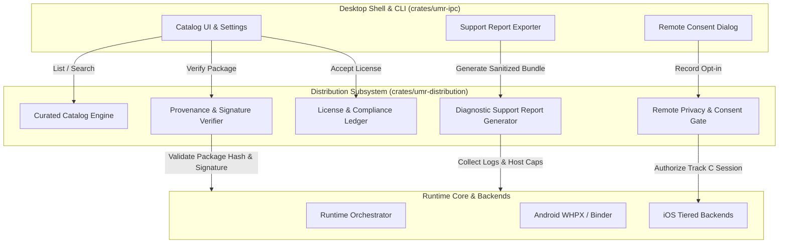

# ADR 0008: Curated Catalog, Package Provenance Verification, and Distribution Security

- **Status:** Accepted
- **Date:** 2026-10-15
- **Decision owners:** Engineering Lead, System Architect, Security Lead
- **Related requirement(s):** G1, G4, FR-UI-01..04, FR-PKG-01..05, NFR-SEC-01, NFR-OBS-01, NFR-LIC-01
- **Related ADR(s):** ADR 0001, ADR 0002, ADR 0006, ADR 0007

---

## 1. Context

In Phase 5, the Universal Mobile Runtime (UMR) expands from local execution to distribution, publisher onboarding, catalog curation, and ecosystem operations. 

Running mobile applications on desktop hosts presents distinct distribution and security hazards:
1. **Malicious or Tampered Packages:** Arbitrary sideloaded APKs or IPAs may contain trojans, spyware, or repackaged malware designed to compromise the host.
2. **Supply-Chain & Downgrade Attacks:** Attackers could attempt to trick the runtime into installing an older, vulnerable version of an application (downgrade/rollback attack) or replacing package binaries with unauthorized builds.
3. **Intellectual Property & Licensing Compliance:** Commercial App Store packages encrypted with Apple FairPlay DRM or restricted by proprietary store agreements cannot be distributed or executed without violation of developer agreements (NFR-LIC-01, ADR 0006). Applications must provide clear license attribution and EULA disclosure.
4. **Remote Runtime Privacy Risks:** Running applications via Track C (remote device streaming or cloud runner) transmits sensitive framebuffers, keystrokes, touch gestures, and clipboard data over external networks. Users must have transparent control and explicit consent.
5. **Sensitive Information Leakage in Support Logs:** Diagnostic bundles exported for debugging often capture authentication tokens, device identifiers, email addresses, or proprietary app assets.

---

## 2. Decision Drivers

- **Cryptographic Trust & Provenance:** Packages from the curated catalog must have verifiable authenticity, integrity, and publisher identity before execution.
- **Rollback / Downgrade Prevention:** Updates must enforce monotonic version increments and originate from the same verified publisher key.
- **Explicit Privacy Governance:** Remote execution and diagnostic telemetry must be strictly opt-in with human-readable disclosures and auditable consent records.
- **Automated PII/Secret Scrubbing:** Diagnostic support reports must redact sensitive data by default before export.
- **Separation of Concerns:** Distribution, catalog querying, and license compliance must not pollute hypervisor or backend execution code, remaining accessible via stable IPC to desktop shells.

---

## 3. Decision

We establish the **UMR Distribution & Ecosystem Architecture** implemented in `crates/umr-distribution`:

### Key Architectural Pillars:

1. **Curated Catalog Manifest & Canonical Schema:**
   - Every catalog entry specifies `app_id`, `publisher_id`, `version`, `package_hash_sha256`, `signature`, `min_runtime_version`, `license_type`, `required_capabilities`, and `privacy_disclosures`.
   - Signatures are verified against the publisher's registered public key or UMR root authority.

2. **Package Provenance & Anti-Downgrade Ledger:**
   - Packages are assigned a provenance status: `CatalogVerified`, `DeveloperSideload`, `Untrusted`, or `SignatureInvalid`.
   - Update verification checks:
     - The publisher public key matches the existing installed app.
     - The new version string/code is strictly monotonic (`new_version >= current_version`).
     - Binary SHA-256 digest matches the signed digest.

3. **License & Compliance Ledger:**
   - Records user acceptance timestamp, license type, and terms hash.
   - Blocks launch if mandatory terms (e.g. proprietary EULA or special permissions) have not been consented to.
   - Enforces rejection of FairPlay DRM protected binaries (`cryptid != 0`).

4. **Remote Execution Privacy Gate:**
   - Gating mechanism for Track C (Remote Stream): No remote session may be initiated unless a valid `UserConsentRecord` is actively registered for the session host.
   - Watermarking and UI labeling remain mandatory: All remote frames and status reports must display `RemoteStream`.

5. **Diagnostic Support Report Generator with Active Redaction:**
   - Generates structured JSON/ZIP diagnostic bundles containing host details, UMR version, backend status, and execution logs.
   - Automatically sanitizes sensitive patterns (bearer tokens, private keys, passwords, email addresses, absolute user home directory paths) replacing them with `[REDACTED_SECRET]` and `[REDACTED_PATH]`.

---

## 4. Consequences

### Positive
- Users and enterprises gain verified supply-chain security for mobile apps running on desktop hosts.
- Downgrade attacks and malicious package tampering are cryptographically prevented.
- Complete regulatory and legal compliance regarding DRM, open source attribution, and remote telemetry privacy.
- Support reports can be safely shared with developers without leaking host passwords or auth tokens.

### Negative / Trade-offs
- Publishers must generate and manage signing keys and catalog metadata.
- Sideloaded unverified packages run in an isolated/restricted mode with clear warning indicators.

---

## 5. Security & Verification Strategy
- Zero `unsafe` Rust across all distribution, parsing, and report generation code.
- Cryptographic digests computed using standard SHA-256 (`sha2`).
- 100% test coverage over tampered packages, invalid signatures, downgrade attempts, missing remote consent, and secret redaction.

