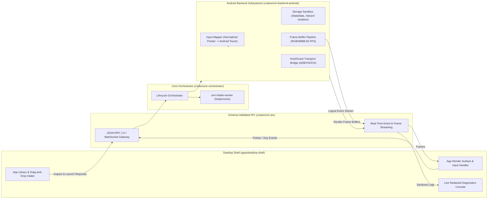

# Feature Specification: Phase 2 Android Backend Depth & Desktop Shell Integration

- **Status:** Draft / Ready for Review
- **Owner:** System Architect & Desktop Shell Lead
- **Related requirement(s):** G1, G2, G4, G5, FR-UI-01..04, FR-RUN-01..05, NFR-SEC-01, NFR-REL-01, NFR-OBS-01
- **Related ADR(s):** [ADR 0001](file:///d:/Projects/universal-mobile-runtime/docs/adr/0001-desktop-first.md), [ADR 0002](file:///d:/Projects/universal-mobile-runtime/docs/adr/0002-multiple-backends.md), [ADR 0005](file:///d:/Projects/universal-mobile-runtime/docs/adr/0005-android-backend-architecture.md), [ADR 0007](file:///d:/Projects/universal-mobile-runtime/docs/adr/0007-core-language-rust.md)

---

## 1. Problem & Objectives

Phase 1 successfully proved the minimal vertical slice: sandboxed package intake, capability negotiation, state machine transitions, and reference execution in Rust with 23 passing tests. However, the runtime currently lacks:
1. **Desktop Shell Integration:** A graphical user interface providing an application library, drag-and-drop intake, live execution window, and structured diagnostic drawer.
2. **Standardized Decoupled IPC:** A schema-validated, asynchronous IPC gateway connecting the UI to the orchestrator without linking untrusted runtime binaries into the presentation process.
3. **Android Backend Depth:** Subsystems for normalized input translation (mouse/touch/keyboard to Android events), application storage sandboxing (`/data/data/<pkg>` isolation), and frame buffer streaming for display presentation.

---

## 2. Architecture & Workstreams

---

## 3. Scope & Deliverables

### Workstream 1: IPC Gateway (`crates/umr-ipc`)
- Typed JSON-RPC 2.0 message protocol over localhost WebSocket or local IPC.
- RPC Methods:
  - `umr.intake.inspect`: Calls isolated intake worker, returns validated metadata.
  - `umr.negotiate`: Evaluates package against host backends.
  - `umr.session.prepare`: Allocates session sandbox.
  - `umr.session.launch`: Spawns supervised runner.
  - `umr.session.stop`: Gracefully terminates session.
  - `umr.session.status`: Polls lifecycle state (`Preparing`, `Running`, `Stopping`, `Terminated`, `Failed`).
  - `umr.session.input_event`: Dispatches mouse/touch/key events to active session.
  - `umr.backends.list`: Returns registered backend capability records.
- Streaming Channels:
  - Real-time sanitized log events.
  - Framebuffer update notifications / frame buffers.

### Workstream 2: Android Backend Depth (`crates/umr-backend-reference` & `crates/umr-backend-android`)
- **Input Event Mapping:**
  - Converts normalized coordinate events `PointerEvent { x: f32, y: f32, action: Down | Move | Up }` into Android motion events.
  - Converts keyboard events `KeyEvent { key_code: u32, action: KeyDown | KeyUp }` into Android key events.
- **Filesystem & Storage Virtualization:**
  - Creates dedicated data directories per package (`sandbox/data/data/<pkg>` and `sandbox/sdcard/Android/data/<pkg>`).
  - Implements clean data wipe on app uninstall or reset.
- **Display & Frame Buffer Pipeline:**
  - Framebuffer generator/compositor delivering RGBA8888 buffers (portrait 1080x1920 or landscape 1920x1080).
  - Frame delivery timestamping and frame-pacing statistics (FPS, frame drop count).
- **Transport Bridge:**
  - Transport manager capable of dispatching commands to local AOSP runners or ADB-connected targets.

### Workstream 3: Desktop Shell Application (`apps/desktop-shell`)
- Modern, desktop-native responsive application interface:
  - **Library View:** Displays installed/imported apps, package icons, versions, SDK requirements, and honest execution mode badges (`Local (Native)`, `Local (Virtualized)`, `Remote / Device Stream`, `Unsupported`).
  - **Intake Drop Zone:** Visual drag-and-drop area for APK/IPA files with real-time feedback and structured diagnostic error popups.
  - **Execution Window:** Phone-frame viewport rendering active app frames, touch/pointer interaction, Back/Home/Recents buttons.
  - **Live Diagnostics Drawer:** Searchable, filterable real-time stream of sanitized logcat/system logs with one-click diagnostic report export.

---

## 4. Acceptance Criteria (Phase 2)

- [ ] **AC2-1 (IPC Protocol):** The IPC gateway executes asynchronous JSON-RPC commands and streaming notifications with schema validation and error isolation.
- [ ] **AC2-2 (Input Mapping):** Pointer events (click, drag, release) and keyboard typing sent from the Desktop Shell are accurately mapped and processed by the Android backend without latency spikes.
- [ ] **AC2-3 (Storage Isolation):** Every Android session executes within an isolated filesystem sandbox; app data remains segregated and can be retained or purged upon request.
- [ ] **AC2-4 (Frame Presentation):** The Android backend generates and streams RGBA frame buffers to the Desktop Shell viewport, achieving steady frame pacing.
- [ ] **AC2-5 (UI Library & Drag-and-Drop):** Users can drop APK/IPA packages onto the desktop shell, view parsed metadata, and receive actionable error dialogs if an invalid or encrypted package is dropped.
- [ ] **AC2-6 (Interactive Controls):** Users can launch, interact with, pause, and stop apps via the desktop shell, and view real-time sanitized logcat entries in the diagnostic drawer.
- [ ] **AC2-7 (Honest Mode Presentation):** The UI strictly presents execution modes matching backend negotiation (`Local Native`, `Local Virtualized`, `Remote / Device Stream`, or `Unsupported`).

---

## 5. Implementation Sequence

1. **Step 2.1: IPC Gateway Crate (`crates/umr-ipc`):** Implement JSON-RPC protocol, message schemas, and local async server.
2. **Step 2.2: Android Subsystems (Input, Storage, Framebuffer):** Implement input dispatcher, isolated storage sandbox, and frame generator in the Android backend.
3. **Step 2.3: Desktop Application Shell (`apps/desktop-shell`):** Implement the presentation UI (Library, Viewport, Diagnostics) and connect to the IPC gateway.
4. **Step 2.4: End-to-End Integration & Verification:** Test interactive session flow from GUI intake to frame rendering, touch interaction, and teardown.

