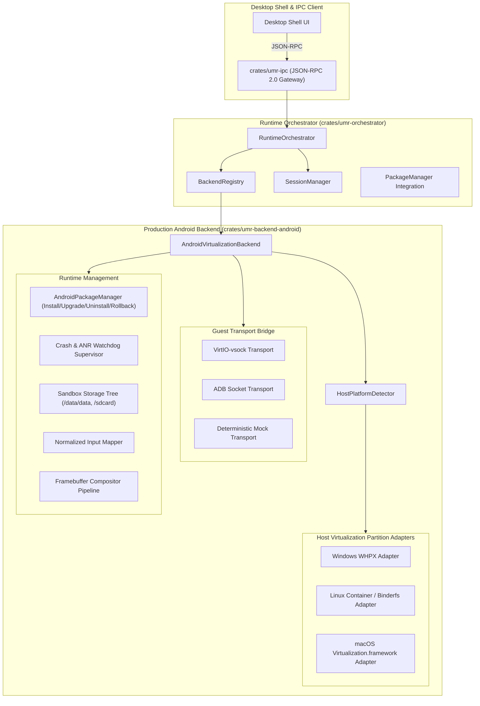

# Feature Specification: Phase 3 Cross-Host Virtualization & Adapters

- **Status:** Draft / Ready for Implementation
- **Owner:** System Architect & Android Backend Lead
- **Related requirement(s):** G1, G2, G4, G5, FR-UI-01..04, FR-RUN-01..05, FR-PKG-01..05, FR-COMP-01..03, NFR-SEC-01, NFR-REL-01, NFR-OBS-01, NFR-PORT-01, NFR-TEST-01
- **Related ADR(s):** [ADR 0001](file:///d:/Projects/universal-mobile-runtime/docs/adr/0001-desktop-first.md), [ADR 0002](file:///d:/Projects/universal-mobile-runtime/docs/adr/0002-multiple-backends.md), [ADR 0004](file:///d:/Projects/universal-mobile-runtime/docs/adr/0004-host-and-target-architecture-baseline.md), [ADR 0005](file:///d:/Projects/universal-mobile-runtime/docs/adr/0005-android-backend-architecture.md), [ADR 0007](file:///d:/Projects/universal-mobile-runtime/docs/adr/0007-core-language-rust.md)

---

## 1. Problem & Objectives

Phase 1 established the core vertical slice with defensive package intake and lifecycle management. Phase 2 delivered the interactive desktop shell UI, schema-validated JSON-RPC gateway, and core Android subsystems (input mapping, storage sandboxing, 60 FPS framebuffer compositing).

However, runtime execution is currently anchored to a reference local runner. To fulfill the product vision across Windows, macOS, and Linux desktop hosts:
1. **Host-Specific Virtualization & Partitioning:** The runtime must detect the host OS and CPU capabilities, configuring the appropriate isolation mechanism:
   - **Windows:** MicroVM partition management via Windows Hypervisor Platform (WHPX) with VirtIO device definitions (VirtIO-GPU, VirtIO-vsock, VirtIO-input).
   - **Linux:** Native container configuration with user/pid/mount/network namespaces, cgroups v2 limits, and `/dev/binderfs` mount negotiation.
   - **macOS:** Apple `Virtualization.framework` microVM configuration with Rosetta 2 directory sharing for x86_64 guest translation on Apple Silicon.
2. **Guest Transport Bridge:** A robust guest communication pipeline supporting VirtIO-vsock and ADB socket transport (`127.0.0.1:5555`) for command execution, input event dispatch, frame buffer capture, and real-time logcat streaming.
3. **Persistent Package Management:** Multi-package catalog tracking, install/uninstall lifecycle, storage directory allocation, version upgrades with state preservation, and atomic upgrade rollback on failure.
4. **Resilience & Crash Recovery:** Watchdog supervisor monitoring guest session health, detecting application crashes and ANRs, extracting sanitized crash diagnostics, and recovering gracefully without crashing the desktop shell.

---

## 2. Architecture & Workstreams



---

## 3. Scope & Detailed Specifications

### Workstream 1: Host Detection & Virtualization Partitioning
- **Host Detection (`HostPlatformDetector`):**
  - Detects host operating system (`windows`, `linux`, `macos`) and architecture (`x86_64`, `aarch64`).
  - Evaluates hardware virtualization features (Hyper-V / WHPX presence on Windows, KVM / Binderfs on Linux, Hypervisor.framework on macOS).
  - Matches inspected package ABIs against host & guest capabilities.
- **WHPX Adapter (`WhpxAdapter`):**
  - Formulates Windows Hypervisor Platform partition specifications:
    - MicroVM configuration: vCPUs (min 2, max host logical cores - 1), RAM (2048 MB default).
    - VirtIO device tree: VirtIO-GPU, VirtIO-vsock (CID 3), VirtIO-input, VirtIO-net.
    - Kernel command line arguments for headless AOSP initialization.
- **Linux Container Adapter (`LinuxContainerAdapter`):**
  - Configures Linux namespace isolation (CLONE_NEWNS, CLONE_NEWPID, CLONE_NEWIPC, CLONE_NEWUTS).
  - Configures cgroups v2 resource controllers (memory.max, cpu.max).
  - Mounts `/dev/binderfs` nodes (`binder`, `hwbinder`, `vndbinder`).
- **macOS Virtualization Adapter (`MacVirtAdapter`):**
  - Configures `Virtualization.framework` virtual machine description.
  - Configures Rosetta 2 directory sharing (`vz_rosetta_share`) for executing x86_64 binaries in ARM64 guest on Apple Silicon.

### Workstream 2: Guest Transport Bridge
- **`GuestTransport` Contract:**
  ```rust
  pub trait GuestTransport: Send + Sync {
      fn execute_command(&self, cmd: &str) -> UmrResult<CommandOutput>;
      fn send_input(&self, event: &InputEvent) -> UmrResult<()>;
      fn capture_frame(&self) -> UmrResult<Option<FrameBuffer>>;
      fn stream_logs(&self) -> UmrResult<Vec<String>>;
      fn is_alive(&self) -> bool;
  }
  ```
- **ADB Socket Transport (`AdbTransport`):**
  - Manages loopback TCP connection to ADB daemon (`127.0.0.1:5555`).
  - Handles ADB message protocol frames (`CNXN`, `OPEN`, `WRTE`, `OKAY`, `CLSE`).
  - Dispatches `am start`, `pm install`, `input tap/keyevent`, `screencap`, and `logcat` commands.
- **VirtIO-vsock Transport (`VsockTransport`):**
  - Low-latency host-guest zero-network socket descriptor (guest CID, port).
- **Deterministic Mock Transport (`MockGuestTransport`):**
  - High-fidelity in-memory transport emulator for automated testing without requiring a live microVM or device.

### Workstream 3: Persistent Package Management & Upgrades
- **Package Registry & Catalog (`AndroidPackageManager`):**
  - Persistent JSON database in sandbox root: `<sandbox>/packages/catalog.json`.
  - Catalog Record:
    - Package Name (e.g. `org.umr.synthetic.hello`).
    - Version Code & Version Name.
    - Target SDK & Min SDK.
    - Supported ABIs & Pure DEX flag.
    - Installed APK path and SHA-256 hash.
    - Storage quota and data directory paths.
    - Install timestamp and last launch timestamp.
- **Installation Lifecycle:**
  - Validates package integrity and hash.
  - Verifies no collision or handles upgrade cleanly.
  - Creates sandbox directories (`data/data/<pkg>`, `sdcard/Android/data/<pkg>`).
- **Upgrade & Downgrade Protection:**
  - Verifies new package version code >= current version code.
  - Protects user data during upgrade (preserves `/data/data/<pkg>`).
  - Atomic transaction: rolls back if package installation fails.
- **Uninstallation Lifecycle:**
  - Terminates running session if active.
  - Purges sandbox data directories (`wipe_storage`).
  - Removes entry from catalog.

### Workstream 4: Crash Watchdog & Resilience
- **Watchdog Supervisor (`WatchdogSupervisor`):**
  - Heartbeat monitor polling guest session state every interval.
  - ANR detection: triggers if application does not respond to input or frame update within timeout.
  - Crash dump extraction: when guest process terminates with non-zero exit code or signal, captures last 100 logcat lines, extracts stack trace, and constructs structured `DiagnosticError`.
  - Shell isolation: ensures backend crashes never crash `umr-ipc` or the desktop shell (NFR-REL-01).

### Workstream 5: RPC Extensions & Orchestrator Integration
- New JSON-RPC Methods:
  - `umr.host.capabilities`: returns host OS, CPU, hypervisor availability, and optimal backend selection.
  - `umr.packages.list`: returns array of installed package records.
  - `umr.packages.install`: imports and registers an APK into the persistent catalog.
  - `umr.packages.uninstall`: removes package and purges all storage.
  - `umr.packages.upgrade`: performs version-validated package upgrade.

---

## 4. Acceptance Criteria (Gate 3 Verification)

- **AC3-1 (Host Detection):** Host platform detector accurately identifies Windows, Linux, and macOS host OS and x86_64/ARM64 architectures with virtualization capabilities.
- **AC3-2 (Partition Adapters):** WHPX, Linux container, and macOS virtualization partition adapters produce valid, schema-compliant hypervisor and isolation configurations.
- **AC3-3 (Guest Transport):** ADB and VirtIO-vsock transport abstractions handle command dispatch, input translation, logcat streaming, and frame buffer capture.
- **AC3-4 (Package Catalog):** Multi-package catalog persists across restarts in sandbox directory.
- **AC3-5 (Upgrade & Downgrade Validation):** Package upgrade preserves application user data; downgrade without force flag is cleanly rejected with `ErrIntakeInvalidPackage`.
- **AC3-6 (Clean Uninstallation):** Uninstallation completely wipes `/data/data/<pkg>` and removes package from catalog.
- **AC3-7 (Crash Recovery & ANR):** Watchdog detects anomalous process exit, extracts crash diagnostics, transitions session to `Failed`, and keeps orchestrator and IPC responsive.
- **AC3-8 (Support Matrix Update):** All verified tests are recorded in `docs/05-platform-support-matrix.md`.

