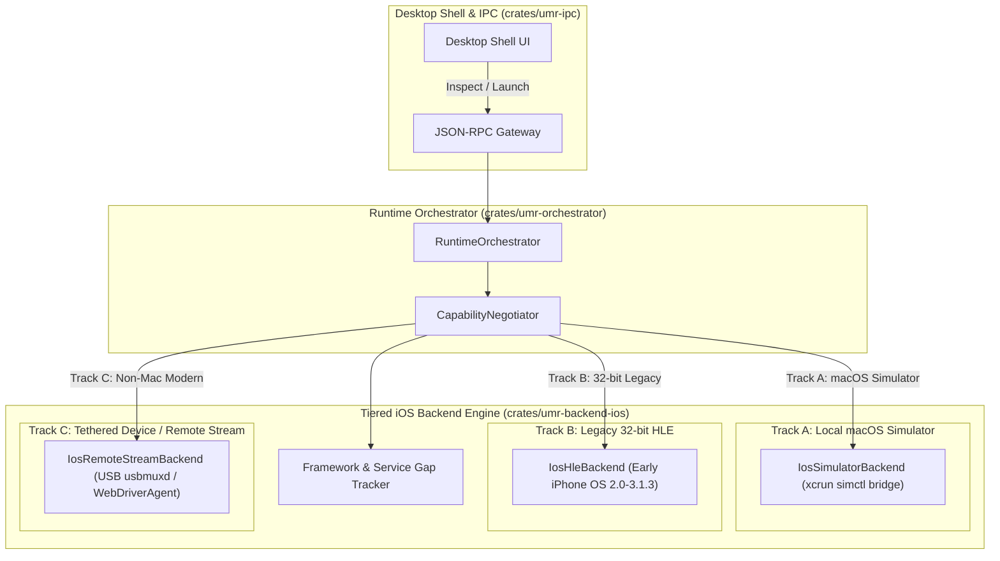

# Feature Specification: Phase 4 iOS Backend Expansion & Feasibility

- **Status:** Draft / Ready for Implementation
- **Owner:** iOS Architecture Lead & System Architect
- **Related requirement(s):** G1, G3, G4, G5, FR-UI-01..04, FR-RUN-01..05, FR-PKG-01..05, FR-COMP-01..03, NFR-SEC-01, NFR-REL-01, NFR-OBS-01, NFR-PORT-01, NFR-TEST-01
- **Related ADR(s):** [ADR 0001](file:///d:/Projects/universal-mobile-runtime/docs/adr/0001-desktop-first.md), [ADR 0002](file:///d:/Projects/universal-mobile-runtime/docs/adr/0002-multiple-backends.md), [ADR 0003](file:///d:/Projects/universal-mobile-runtime/docs/adr/0003-ios-feasibility-gate.md), [ADR 0006](file:///d:/Projects/universal-mobile-runtime/docs/adr/0006-ios-feasibility-selection.md), [ADR 0007](file:///d:/Projects/universal-mobile-runtime/docs/adr/0007-core-language-rust.md)

---

## 1. Problem & Objectives

Broad native iOS execution across non-Apple desktop operating systems (Windows, Linux) is fundamentally constrained by:
1. Immense proprietary framework surface (UIKit, Metal, CoreAnimation, CoreData, system daemons).
2. Apple FairPlay binary encryption on commercial App Store IPAs (`cryptid != 0`).
3. Apple EULA terms restricting macOS and the iOS SDK/Simulator to Apple-branded hardware.

To satisfy Round 1 commitments **without resorting to fake mocks, misleading UI claims, or unvetted DRM circumvention**, ADR 0006 mandates a **Tiered Execution Strategy**:
- **Track A (Local Execution on macOS):** Integrated Apple Simulator runtime (`xcrun simctl`) for simulator-targeted app builds (`is_simulator_build: true`).
- **Track B (Local Legacy Emulation on Windows, macOS, Linux):** High-Level Emulation (HLE) engine for early 32-bit iOS applications (iPhone OS 2.0 - 3.1.3, ARMv6/v7, early UIKit/OpenGL ES).
- **Track C (Remote Modern iOS Execution on Windows, Linux):** Authenticated bridge to tethered physical devices or remote macOS test runners, with mandatory **"Remote / Device Stream"** labeling in product UI, session metadata, and diagnostic logs.

In addition, Phase 4 requires a **Framework & Service Gap Tracker** that audits imported application packages, identifying missing APIs, unsupported cloud services, and entitlements before launch.

---

## 2. Architecture & Workstreams

---

## 3. Scope & Detailed Specifications

### Workstream 1: Framework & Service Gap Tracker (`gap_tracker.rs`)
- **Framework Audit:**
  - Audits linked frameworks and dylibs from inspected package metadata.
  - Classifies framework support level:
    - **Supported:** Base Foundation, CoreGraphics (2D primitives), CoreFoundation, libSystem, OpenGLES 1.1/2.0.
    - **Partial / Shimmed:** Early UIKit (UIView, UIViewController, UIButton, UILabel, UITableView), OpenAL, AudioToolbox.
    - **Unsupported (Gaps):** Metal, CoreData, CloudKit, PushKit, StoreKit (In-App Purchases), PassKit (Apple Pay), GameCenter, HealthKit, CallKit.
- **Entitlements & Signing Audit:**
  - Checks FairPlay DRM (`cryptid != 0` -> immediate rejection `ErrIntakeDrmProtected`).
  - Checks Apple Developer Team ID, bundle entitlements (APNs push tokens, Keychain sharing, App Groups).
- **Structured Gap Analysis Report:**
  - Emits `GapAnalysisReport` with overall compatibility verdict (`Supported`, `Partial`, `Unsupported`, `Blocked`).

### Workstream 2: Track A — Local macOS Simulator Backend (`simulator.rs`)
- `IosSimulatorBackend` implementing `IIosBackend`:
  - ID: `ios-mac-simulator`.
  - Mode: `ExecutionMode::LocalNative`.
  - Only available on macOS hosts (`cfg!(target_os = "macos")` or simulated in tests).
  - Lifecycle:
    - `prepare`: verifies `is_simulator_build == true`, creates session workdir.
    - `launch`: executes `xcrun simctl launch` for bundle ID.
    - `send_input`: translates pointer/touch coordinates to simulator events.
    - `capture_frame`: extracts screenshot buffer via `xcrun simctl io screenshot`.
    - `stop`: terminates simulated app process via `xcrun simctl terminate`.
    - `collect_diagnostics`: streams `os_log` filtered to application subsystem.

### Workstream 3: Track B — Legacy 32-bit iOS HLE Backend (`hle.rs`)
- `IosHleBackend` implementing `IIosBackend`:
  - ID: `ios-legacy-hle`.
  - Mode: `ExecutionMode::LocalHle`.
  - Target Cohort: iPhone OS 2.0 through 3.1.3 applications compiled for 32-bit ARM (ARMv6 / ARMv7).
  - Strict Boundary Enforcement:
    - Rejects 64-bit binaries (ARM64) with `ErrBackendIncompatibleArchitecture`.
    - Rejects modern minimum OS requirements (> iOS 4.0) with `ErrBackendIncompatibleApiLevel`.
  - Compositor: Generates 320x480 native resolution frame buffers with status bar and app canvas.
  - Input: Dispatches normalized pointer touches to 320x480 coordinate space.

### Workstream 4: Track C — Remote Device / Tethered Stream Backend (`remote_stream.rs`)
- `IosRemoteStreamBackend` implementing `IIosBackend`:
  - ID: `ios-remote-stream`.
  - Mode: `ExecutionMode::RemoteStream`.
  - Enforces explicit **"Remote / Device Stream"** labeling in UI badges, session metadata, logs, and watermarked frame buffers.
  - Lifecycle:
    - `prepare`: connects to local `usbmuxd` socket or network relay.
    - `launch`: triggers remote application launch via authenticated device bridge.
    - `send_input`: forwards touch/key events across bridge.
    - `capture_frame`: returns streamed video frame buffer with remote watermarking metadata.
    - `stop`: releases remote session handle.
    - `collect_diagnostics`: streams `syslog` from tethered device.

### Workstream 5: IPC & Desktop Shell Extensions
- New JSON-RPC Method:
  - `umr.ios.gap_report`: runs framework gap analysis on inspected package path.
- Updated `umr.backends.list`: reports registered iOS backends with honest execution modes (`LocalNative`, `LocalHle`, `RemoteStream`).

---

## 4. Acceptance Criteria (Gate 4 Verification)

- **AC4-1 (Simulator Backend):** `IosSimulatorBackend` executes full lifecycle for simulator-targeted app packages on macOS or test mock.
- **AC4-2 (Legacy HLE Backend):** `IosHleBackend` executes early 32-bit ARMv7 apps in 320x480 resolution and strictly rejects ARM64 packages.
- **AC4-3 (Remote Stream Backend):** `IosRemoteStreamBackend` manages tethered device sessions and mandates `Remote / Device Stream` labeling.
- **AC4-4 (Gap Tracker):** Framework gap analyzer accurately detects and catalogs UIKit, Metal, StoreKit, and CloudKit gaps.
- **AC4-5 (Capability Negotiation):** Capability negotiator accurately routes Track A on macOS, Track B for 32-bit legacy, Track C for non-macOS modern, and rejects FairPlay DRM.
- **AC4-6 (Support Matrix Update):** All verified tests are recorded in `docs/05-platform-support-matrix.md`.

