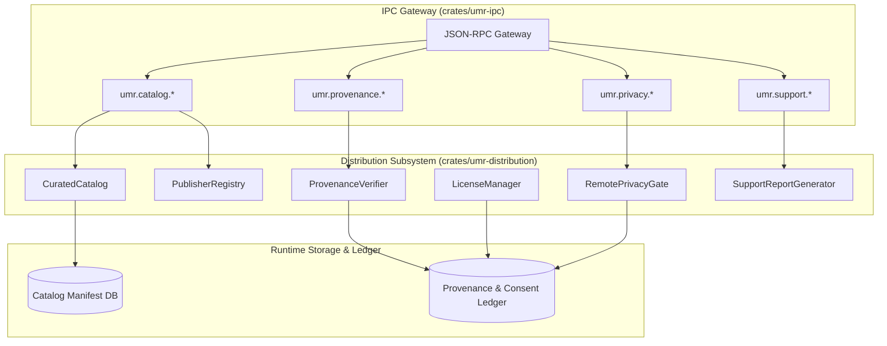

# Feature Specification: Phase 5 Distribution, Ecosystem & Security Operations

- **Status:** Draft / Ready for Implementation
- **Owner:** Distribution Lead, Security Architect & Systems Lead
- **Related requirement(s):** G1, G4, FR-UI-01..04, FR-PKG-01..05, FR-RUN-01..05, FR-COMP-01..03, NFR-SEC-01, NFR-REL-01, NFR-OBS-01, NFR-PORT-01, NFR-TEST-01, NFR-LIC-01
- **Related ADR(s):** [ADR 0001](file:///d:/Projects/universal-mobile-runtime/docs/adr/0001-desktop-first.md), [ADR 0002](file:///d:/Projects/universal-mobile-runtime/docs/adr/0002-multiple-backends.md), [ADR 0006](file:///d:/Projects/universal-mobile-runtime/docs/adr/0006-ios-feasibility-selection.md), [ADR 0007](file:///d:/Projects/universal-mobile-runtime/docs/adr/0007-core-language-rust.md), [ADR 0008](file:///d:/Projects/universal-mobile-runtime/docs/adr/0008-curated-catalog-provenance-and-privacy.md)

---

## 1. Problem & Objectives

Phase 5 transitions the Universal Mobile Runtime (UMR) from a developer/local execution engine into a secure, transparent distribution ecosystem. 

Desktop environments present distinct distribution risks when running mobile applications:
1. **Unverified Packages & Malicious Sideloading:** Sideloading raw packages without provenance or signature validation leaves users vulnerable to malware and repackaged binaries.
2. **Update Tampering & Downgrade Attacks:** Without cryptographic verification and version monotonicity checks, an attacker could deliver modified packages or roll back to vulnerable versions.
3. **Licensing & FairPlay DRM Compliance:** Commercial store packages and proprietary licenses must be handled lawfully. Apps requiring DRM (`cryptid != 0`) must be rejected, and software license terms must be transparently disclosed.
4. **Remote Runtime Privacy:** Remote execution (Track C) streams application screens, touch interactions, and diagnostic metrics over networks. Users must explicitly opt in with informed consent.
5. **Support Report Data Scrubbing:** Diagnostic support reports submitted for troubleshooting must redact personal identifiable information (PII), authentication tokens, and user credentials.

---

## 2. Architecture & Workstreams

---

## 3. Scope & Detailed Specifications

### Workstream 1: Curated Catalog & Publisher Registry (`catalog.rs`, `publisher.rs`)
- **Publisher Registry:**
  - Entity: `Publisher` with `id`, `name`, `public_key`, `contact_uri`, `verified: bool`.
  - Registration and key lookup for package signature verification.
- **Catalog Manifest:**
  - Entity: `CatalogEntry` containing:
    - `app_id`: canonical reverse-DNS identifier (e.g. `com.example.mobileapp`).
    - `publisher_id`: identifier linking to `Publisher`.
    - `version`: semantic or build version string.
    - `version_code`: integer monotonic counter.
    - `package_family`: `PackageFamily::Android` or `PackageFamily::Ios`.
    - `package_hash_sha256`: SHA-256 hex digest of the official package.
    - `signature`: cryptographic signature over payload metadata and hash.
    - `min_runtime_version`: minimum UMR version required.
    - `license_type`: SPDX identifier (e.g. "Apache-2.0", "MIT", "Proprietary").
    - `privacy_disclosures`: list of privacy permissions (e.g. "Network", "Microphone", "Storage").
    - `supported_hosts`: list of OS/arch targets (`HostOs`, `HostCpu`).
- **Catalog Operations:**
  - Filtering by search query, platform, architecture, and package family.
  - Adding/updating catalog records with signature validation.

### Workstream 2: Package Provenance & Anti-Downgrade Engine (`provenance.rs`, `verifier.rs`)
- **Provenance Tracking:**
  - Assigns `ProvenanceStatus`:
    - `CatalogVerified`: Valid signature matching a registered, verified publisher.
    - `DeveloperSideload`: Unsigned or self-signed developer package explicitly imported by user.
    - `SignatureInvalid`: Signature present but digest or publisher public key check fails.
    - `Untrusted`: Unknown or blacklisted source.
- **Update Verification & Anti-Downgrade Protection:**
  - `verify_package_update(existing_pkg, new_pkg)`:
    - Verifies publisher public key matches between versions.
    - Enforces monotonicity: `new_pkg.version_code >= existing_pkg.version_code`. Downgrade attempts return `ErrDowngradeDisallowed`.
    - Computes and compares SHA-256 hash of the package binary.

### Workstream 3: Licensing & Compliance Workflow (`license.rs`)
- **License Disclosure & Acceptance:**
  - Tracks user EULA / terms acceptance per application.
  - Entity: `LicenseAcceptanceRecord` (`app_id`, `version`, `license_type`, `accepted_at`, `terms_hash`).
  - Gating: If an app has proprietary or custom license terms requiring explicit acceptance, launch is prevented until `record_acceptance` is invoked.
- **Compliance Rules:**
  - Rejection of DRM-protected binaries (`cryptid != 0` on iOS IPAs).
  - Open source license attribution summary generation.

### Workstream 4: Remote Runtime Security, Privacy Terms & User Consent (`privacy.rs`)
- **Remote Execution Gating:**
  - Mandatory requirement for Track C (Remote Stream) sessions.
  - Entity: `RemoteConsentRecord` (`user_id`, `host_endpoint`, `consented_at`, `terms_version`, `allow_input_streaming: bool`, `allow_frame_streaming: bool`).
  - Verification check: `check_remote_execution_permitted(host_endpoint) -> Result<(), PrivacyError>`.
  - Rejection with `ErrRemoteConsentRequired` if valid consent record is absent.
- **Session Privacy Policy:**
  - Guarantees: All remote sessions display a prominent `RemoteStream` watermark and UI label.
  - Audit logging of session start and termination events without capturing keystrokes or frame pixels.

### Workstream 5: Diagnostic Support Report Generator (`support_report.rs`)
- **Structured Support Bundle:**
  - Generates comprehensive diagnostic reports for troubleshooting:
    - Host environment: OS version, architecture, CPU model, hypervisor capability.
    - UMR engine: version, build timestamp, active backends.
    - Installed application provenance summary.
    - Sanitized event and error logs.
- **Automated Redaction Engine:**
  - Redacts sensitive credentials, tokens, and PII before export:
    - Bearer tokens, private keys, passwords (`[REDACTED_SECRET]`).
    - Email addresses (`[REDACTED_EMAIL]`).
    - Host home directory user paths (`[REDACTED_PATH]`).
    - Device serial numbers / IMEI (`[REDACTED_IDENTIFIER]`).

### Workstream 6: Desktop IPC Gateway Integration (`crates/umr-ipc`)
- Expose the following JSON-RPC methods:
  - `umr.catalog.list`: Query available curated packages with optional filters.
  - `umr.catalog.get`: Retrieve catalog entry and publisher details for an app.
  - `umr.provenance.verify`: Verify package provenance, signature, and update validity.
  - `umr.privacy.get_consent`: Query current remote streaming consent status.
  - `umr.privacy.record_consent`: Submit user consent for remote execution.
  - `umr.support.generate_report`: Generate a sanitized support bundle.

---

## 4. Verification & Gate Criteria (Gate 5)

| Gate Check | Description | Target |
| :--- | :--- | :--- |
| **G5-CAT-01** | Curated catalog manifest query and publisher verification | Verified |
| **G5-SIG-01** | Cryptographic package digest and signature verification | Verified |
| **G5-DOWN-01** | Downgrade protection prevents installing older version codes | Verified |
| **G5-PRIV-01** | Remote execution strictly blocked without explicit consent record | Verified |
| **G5-SAN-01** | Support report export redacts secrets, tokens, and user home paths | Verified |
| **G5-IPC-01** | JSON-RPC endpoints for catalog, provenance, privacy, and support report | Verified |
| **G5-SAFE-01** | 100% safe Rust across all distribution code (zero `unsafe`) | Verified |

